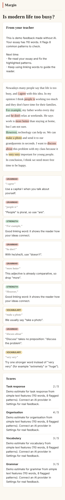

# Margin

**AI-drafted, teacher-approved feedback for EFL writing.**

Students hand in an essay with a class code. An AI drafts rubric scores and inline comments. The teacher keeps, edits or removes each suggestion, then releases the feedback. Margin records every decision, so it can show how often the AI agrees with the teacher, per criterion and per prompt version.

It runs at **$0/month**: one Cloudflare Worker, a D1 database, and a free open model on Workers AI. Teachers can plug in their own Claude or Gemini key for stronger feedback.


## Why it exists

I teach English as a foreign language. Writing feedback is the most valuable thing I give students and the most time-consuming. AI can draft it fast, but a student should never get unchecked AI feedback, and "the AI is good at marking" is a claim that should be measured, not assumed. Margin is built around those two rules:

1. **Nothing reaches a student until a teacher has released it.**
2. **Every teacher decision becomes evaluation data.** The AI's suggested score and the teacher's final score are stored side by side, as are the AI's comments and what the teacher did with them.

## What it does

| | |
|---|---|
| **Teachers** | Create an assignment from a rubric (a starter EFL rubric is built in), share a code, draft feedback for the whole class in one click, review side by side, release. |
| **Students** | No account. Enter the code, hand in, and get a private link where the feedback appears once it's released. |
| **AI accuracy page** | Exact and within-one-band agreement, quadratic weighted kappa, AI bias (too generous or too harsh) per criterion, how many AI comments were kept or rewritten, all split by provider, model and prompt version. |

<p>


</p>

## Engineering highlights

- **The model can't make up quotes.** Every inline comment must quote the essay. Quotes are matched back to the original text (tolerant of case, whitespace and curly quotes), and any comment whose quote isn't in the essay is discarded and counted. See [`shared/text.ts`](shared/text.ts).
- **Validated output, with one self-repair retry.** Model output must match a schema ([`shared/feedback.ts`](shared/feedback.ts)), then pass rubric checks: every criterion scored exactly once and within range. If validation fails, the model gets one retry with the list of problems ([`worker/ai/draft.ts`](worker/ai/draft.ts)).
- **Privacy by default.** Student names, emails, phone numbers and links are masked before an essay is sent to any AI provider. Masks keep the same length, so quote positions still line up with the original essay. Students have no accounts, and their feedback links are random tokens stored only as hashes.
- **Four interchangeable providers** behind one interface ([`worker/ai/provider.ts`](worker/ai/provider.ts)):
  - `free`: Llama 3.3 70B on Cloudflare Workers AI, with JSON-schema output, a per-teacher daily limit, and no key needed.
  - `anthropic`: Claude via the official SDK, with structured outputs, a cached system prompt and server-side refusal fallbacks.
  - `gemini`: REST with a JSON schema.
  - `demo`: rule-based and offline, used for demos and tests.
- **Bring-your-own-key, done safely.** Keys are encrypted with AES-GCM. The teacher and provider ID are bound in as additional authenticated data, so an encrypted key copied to another row won't decrypt. Keys are never returned to the browser; the UI only shows the last 4 characters.
- **The server decides what counts as "accepted".** The client sends final text and keep/remove choices. The server compares them against the stored draft to classify each comment as accepted, edited, rejected or added, so the metrics can't be skewed by the client.
- **Tested against a real database.** The end-to-end API tests run the whole teacher → student → teacher flow, plus authorization and CSRF checks, against a local D1 instance through Wrangler. The kappa implementation is checked against scikit-learn reference values.

## Architecture

```
Browser (React)  ──/api/*──▶  Cloudflare Worker (Hono)  ──▶  D1 (SQLite)
                                     │
                                     ├─▶ Workers AI (free tier, default)
                                     ├─▶ Anthropic API (teacher's key)
                                     └─▶ Gemini API (teacher's key)
```

```
shared/      Pure logic used by server and UI: output schema, validation, quote anchoring,
             PII scrubbing, agreement metrics (QWK, MAE, bias, edit ratio)
worker/      Hono API: auth, routes, AI providers, crypto
src/         React UI (no UI framework, ~1,300 lines)
migrations/  D1 schema
test/        Vitest: unit tests + end-to-end API tests on local D1
```

## Running it locally

Needs Node 22+.

```bash
npm install
cp .dev.vars.example .dev.vars   # then put a random secret in it (command inside)
npm run db:migrate:local
npm run dev                       # http://localhost:5173
npm test
```

Local development works fully offline. To try the free AI tier locally, run `npx wrangler login` and start with `MARGIN_REMOTE_AI=1 npm run dev`. Otherwise, choose **Demo mode** in Settings.

## Deploying for $0

On a free Cloudflare account:

```bash
npx wrangler login
npx wrangler d1 create margin          # paste the printed database_id into wrangler.jsonc
npm run db:migrate:remote
npx wrangler secret put KEY_ENCRYPTION_SECRET   # 32 random bytes, base64
npm run deploy                          # → https://margin.<you>.workers.dev
```

What stays free:

- **Workers:** 100k requests a day.
- **D1:** 5 GB of storage.
- **Workers AI:** a daily free allowance of compute. `FREE_DAILY_LIMIT` in `wrangler.jsonc` caps free drafts per teacher per day, to keep you inside it. Check Cloudflare's current pricing page for exact numbers.

## Roadmap

- [ ] Pilot with real classes, and publish the agreement numbers, including where the AI is weakest
- [ ] Offline eval set: anonymised essays with teacher scores, run in CI against prompt changes
- [ ] Per-student progress across assignments
- [ ] Rubric editor in the UI (the API already supports custom rubrics)
- [ ] Export feedback as PDF for printing

## License

MIT
