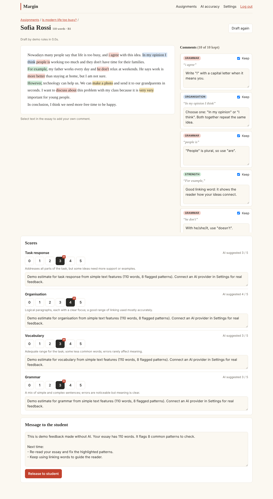
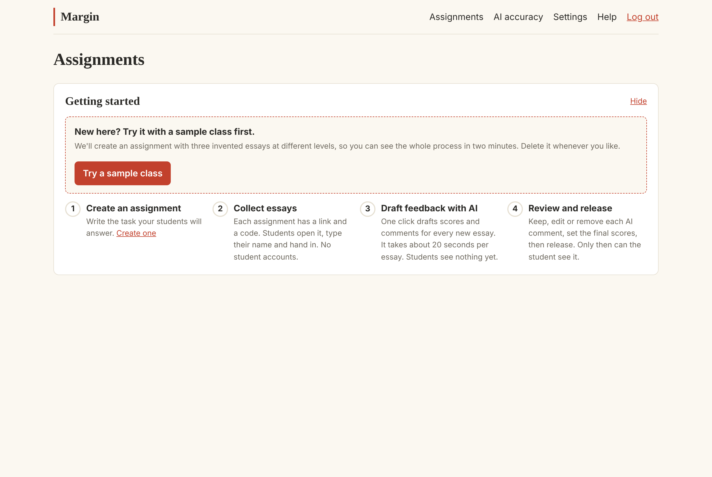
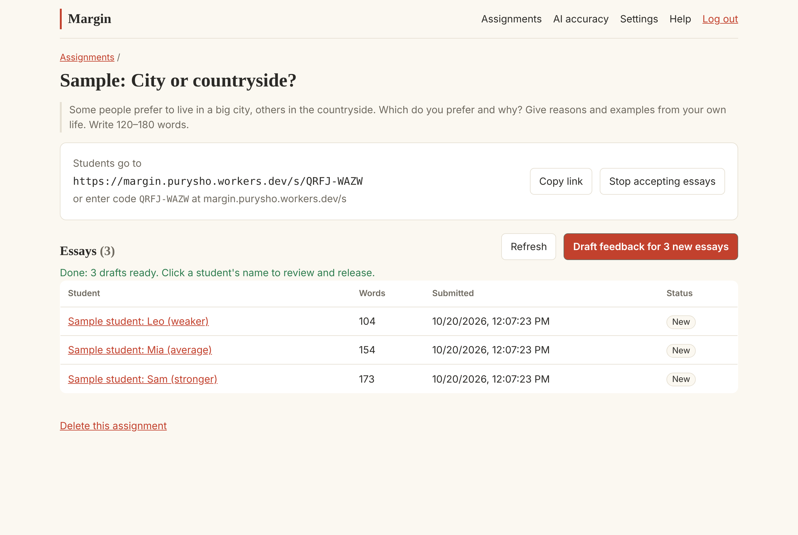
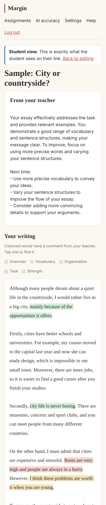
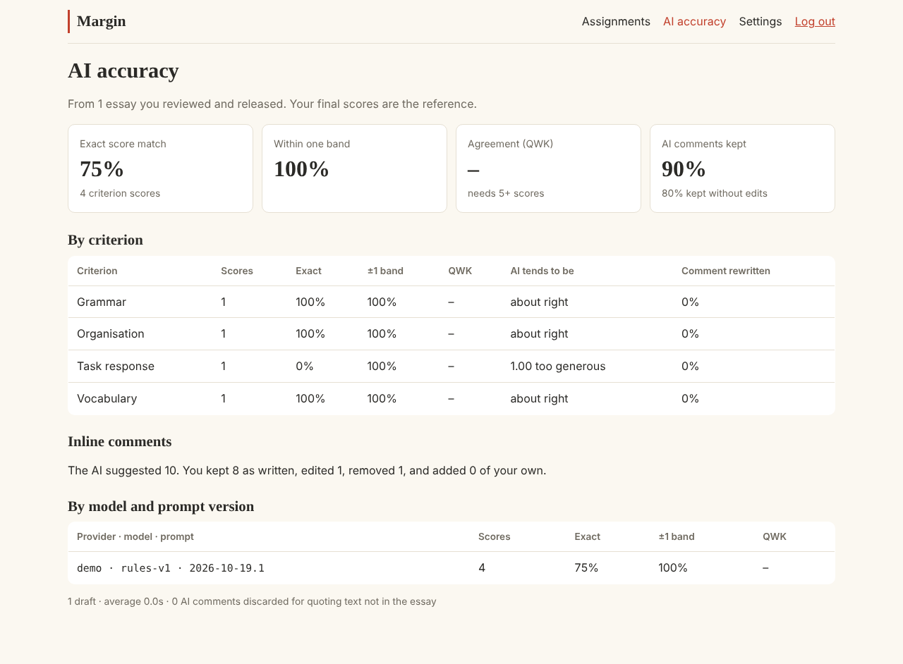
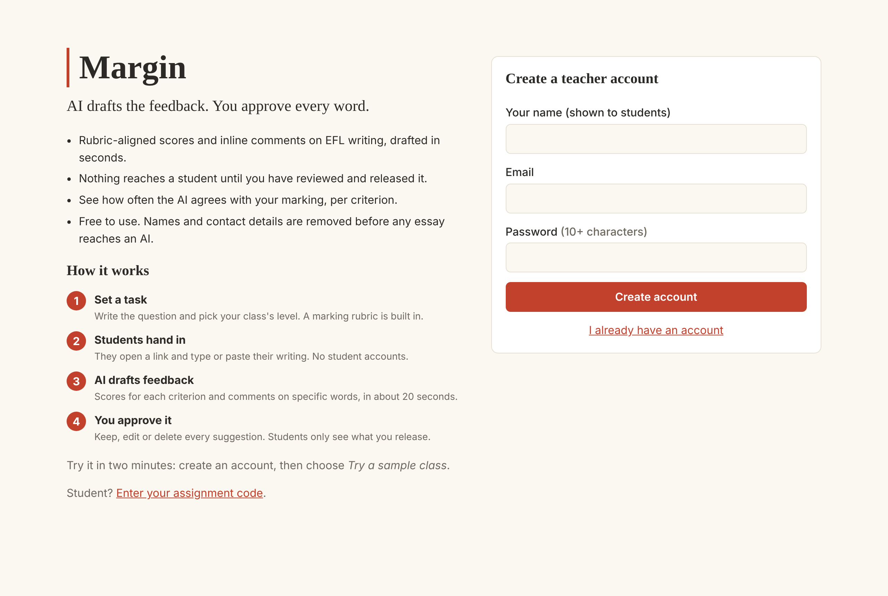
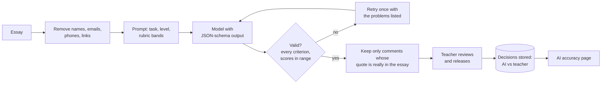

# Margin

AI drafts the feedback. The teacher approves every word.

Margin is a web app for marking student writing in English as a foreign language (EFL). Students hand in an essay with a class link. An AI drafts a score for each rubric criterion and comments on specific words and phrases. The teacher keeps, edits or removes every suggestion, then releases the feedback. Nothing reaches a student before that. Every teacher decision is recorded, so Margin can show how often the AI agrees with the teacher, per criterion and per prompt version.

It runs on free tiers at **$0 a month**, with a free open AI model by default. Teachers can add their own Claude or Gemini key for stronger feedback.



**Try it:** [margin.purysho.workers.dev](https://margin.purysho.workers.dev). Create a teacher account and choose **Try a sample class**. You get three invented essays at different levels and can draft, review and release feedback in about two minutes, without involving any students.

[](https://github.com/purysho/Margin/actions/workflows/ci.yml)

## Why it exists

Written feedback is one of the most useful things a language teacher gives, and one of the slowest. AI can draft it in seconds, but students shouldn't get unchecked AI feedback, and "the AI marks well" is a claim to measure, not assume. Margin is built on two rules:

1. **Nothing reaches a student until a teacher has released it.**
2. **Every teacher decision becomes evaluation data.** The AI's score and the teacher's final score are stored side by side, along with what happened to every AI comment.

## For teachers

- **Assignments in a minute.** Write the task, pick the class's CEFR level (A1–C2), share the link or code. A four-criterion EFL writing rubric is built in: Task response, Organisation, Vocabulary and Grammar, each scored 0–5.
- **One-click drafts for the whole class.** The AI scores each criterion and leaves inline comments (grammar, vocabulary, organisation, task, strengths) worded for the student's level. It takes about 20 seconds per essay.
- **A review screen built for speed.** Click a highlight to jump to its comment, untick *Keep* to remove it, edit the wording, or select any words to add your own comment. The AI's suggested score is marked on each scale; one click changes it.
- **Preview as student,** then release. You can edit and release again at any time.
- **An AI accuracy page.** Shows exact and within-one-band agreement, quadratic weighted kappa, whether the AI marks too generously or too harshly on each criterion, and how many AI comments you kept, edited or removed, split by model and prompt version.
- **Beginner friendly.** A getting-started checklist, a sample class to practise on, first-time tips, and a plain-language help page.

## For students

- No account and nothing to install. Open the link, type a name, paste or write the essay.
- A private feedback link (keep it safe: it's the only way in) where the teacher's released feedback appears: an overall message, scores with comments, and the essay with colour-coded notes. It works on a phone.

## For schools

- **Students are anonymous to the AI.** Names, email addresses, phone numbers and links are removed before an essay is sent to any AI provider.
- **The free tier stays inside Cloudflare.** It uses Workers AI, which does not train on customer data. Bring-your-own-key providers are named in Settings, with a note on each one's data use.
- **Teachers stay in control.** The AI only drafts. Released feedback is always the teacher's version.
- **Data can be deleted.** Deleting an assignment removes all its essays, drafts and feedback.

| Getting started | Drafting the class | Student view (phone) |
| --- | --- | --- |
|  |  |  |

| AI accuracy | Sign-up and how it works |
| --- | --- |
|  |  |

<sub>Screenshots are from the live site using the free model on the built-in sample class. The accuracy numbers come from a quick test review, not real classroom marking. Real results will be published after a classroom pilot.</sub>

## Everyday use

1. **Sign up**, then either **Try a sample class** or **New assignment**: give it a title and task, and choose your students' level.
2. **Share the link** (or the code, which students type at `/s`). Click **Stop accepting essays** when the deadline passes.
3. **Draft feedback** for all new essays in one click. Each takes about 20 seconds; students see nothing yet.
4. **Open each essay** to review: keep, edit or remove comments, set the final scores, edit the message to the student, then **Release**.
5. Check **AI accuracy** now and then to see where the AI can be trusted and where you're correcting it most.

## AI providers

Each teacher chooses in **Settings**. Every draft records which provider, model and prompt version made it.

| Provider | Cost | Setup | Notes |
| --- | --- | --- | --- |
| **Free** (default): Llama 3.3 70B on Cloudflare Workers AI | $0 | None | Runs inside Cloudflare's free daily allowance; 20 drafts per teacher per day by default (`FREE_DAILY_LIMIT`). |
| **Claude**: teacher's own Anthropic key | Pay per essay | Paste a key | Strongest feedback. Structured outputs, a cached system prompt, and automatic fallback if a request is declined. |
| **Gemini**: teacher's own Google AI Studio key | Free tier or paid | Paste a key | Google's free tier may use prompts to improve its products; Settings says so. |
| **Demo**: pattern rules, no AI | $0 | None | Works offline. Used for development and tests. |

Keys are encrypted at rest (AES-GCM, bound to the teacher and provider), never sent back to the browser, and can be removed at any time.

## How the AI feedback works



- **The model can't invent quotes.** Every inline comment must quote the essay. Quotes are matched back to the original text, tolerating case, spacing and curly quotes. A comment whose quote isn't in the essay is discarded and counted. ([`shared/text.ts`](shared/text.ts))
- **Output is validated against the rubric.** Every criterion must be scored exactly once and within range. If not, the model is asked once to fix its answer, given the list of problems. ([`shared/validate.ts`](shared/validate.ts), [`worker/ai/draft.ts`](worker/ai/draft.ts))
- **Masking keeps positions intact.** Masked text has the same length as the original, so quote positions still line up with the real essay.
- **The server decides what was accepted.** The browser sends the final text. The server compares it with the stored draft to classify each comment as accepted, edited, rejected or added, so the accuracy numbers can't be skewed from the browser.
- **The prompt is versioned.** `PROMPT_VERSION` is stored with every draft, so changes to the prompt can be compared on real decisions.

## Measuring the AI

The accuracy page uses only released reviews, with the teacher's final score as the reference:

- **Exact / within one band:** the share of criterion scores where the AI matched the teacher exactly, or was at most one band away.
- **Quadratic weighted kappa (QWK):** the agreement statistic used in automated essay scoring research. 1 is perfect agreement and 0 is chance. It's shown once there are five or more scores. The implementation is tested against scikit-learn reference values.
- **Bias:** the average of AI score minus teacher score. Positive means the AI is too generous.
- **Comments kept / rewritten:** how many AI comments survived review, and how much the teacher changed the wording (normalised edit distance).

## Run your own copy for $0

**From the Cloudflare dashboard (no terminal):**

1. In Workers & Pages, create a Worker and import this repository.
2. Set **Build command** to `npm run build`.
3. Set **Deploy command** to:
   ```
   npx wrangler deploy && npx wrangler d1 migrations apply margin --remote
   ```
   The first deploy creates the `margin` D1 database automatically; the second step creates or updates its tables.
4. Optional, needed only for bring-your-own-key: under **Settings → Variables and Secrets**, add a secret `KEY_ENCRYPTION_SECRET`. Use 32 random bytes, base64-encoded, for example `openssl rand -base64 32`.

**Or from a terminal:**

```bash
npx wrangler login
npx wrangler secret put KEY_ENCRYPTION_SECRET   # optional, see above
npm run deploy                                  # build, deploy, apply migrations
```

What stays free on Cloudflare: Workers (100k requests a day), D1 (5 GB), and a daily Workers AI allowance. `FREE_DAILY_LIMIT` in `wrangler.jsonc` caps free drafts per teacher per day. Check Cloudflare's pricing page for current limits.

## Development

Needs Node 22+.

```bash
npm install
cp .dev.vars.example .dev.vars   # then put a random secret in it (command inside)
npm run db:migrate:local
npm run dev                       # http://localhost:5173
npm test                          # unit tests + end-to-end API tests on a local D1 database
npm run typecheck
```

Local development works offline. Choose **Demo mode** in Settings for drafts without an AI. To use the free Workers AI tier locally, run `npx wrangler login` and start with `MARGIN_REMOTE_AI=1 npm run dev`.

CI runs the type check, all tests and a production build on every push ([`.github/workflows/ci.yml`](.github/workflows/ci.yml)).

## How it's built

- **Cloudflare Workers + [Hono](https://hono.dev)** for the API, serving the React app as static assets from the same Worker.
- **Cloudflare D1 (SQLite)** for storage, with plain SQL migrations in [`migrations/`](migrations).
- **React 19 + Vite** for the UI, with no UI framework: one stylesheet with light and dark themes, a tiny router, and about 1,700 lines of app code.
- **Zod** for request validation and the AI output schema. The JSON schema sent to providers is generated from the same definition.
- **Official Anthropic SDK** for Claude; REST for Gemini; the Workers AI binding for the free tier.
- **Web Crypto only:** PBKDF2 password hashing, AES-GCM key encryption and SHA-256 hashed session and receipt tokens. No crypto dependencies.
- **Vitest** with Wrangler's local platform proxy, so the end-to-end tests run every route against a real local D1 database.

### Project layout

```
shared/          Logic shared by server and UI: AI output schema and validation, quote anchoring,
                 personal-data masking, agreement metrics, starter rubric, sample class
worker/
  index.ts       Hono app, security headers, same-origin checks
  auth.ts        sessions (HttpOnly cookie, hashed token), login guard
  crypto.ts      password hashing, key encryption, tokens, join codes
  ai/            providers (Workers AI, Claude, Gemini, demo), prompt, schema, draft pipeline
  routes/        account, rubrics, assignments, submissions (draft/release), public (students),
                 metrics, onboarding
src/             React app: pages for dashboard, assignment, review, preview, metrics, settings,
                 help, and the student hand-in and feedback pages
migrations/      D1 schema
test/            unit tests and end-to-end API tests
```

## Data model notes

A **rubric** has ordered **criteria**, each with a band descriptor for every score from 0 to its maximum. An **assignment** uses one rubric and has a random join code. A **submission** stores the essay, the student's name and the hash of their private receipt token. Every AI call is kept as an **AI draft**: provider, model, prompt version, validated output, tokens and latency. When the teacher releases, the **review**, **review scores** (AI score next to teacher score) and **review annotations** (each AI comment's fate: accepted, edited, rejected, or added by the teacher) are written in one batch. Re-releasing replaces them. The accuracy page is computed from those tables.

## Roadmap

- [ ] Classroom pilot, then publish the agreement numbers, including where the AI is weakest
- [ ] Offline evaluation set of anonymised essays with teacher scores, run in CI on every prompt change
- [ ] Rubric editor in the UI (the API already accepts custom rubrics)
- [ ] Per-student progress across assignments
- [ ] Export feedback as PDF for printing
- [ ] EduBoard integration: send released scores to the EduBoard gradebook

## License

MIT. See [LICENSE](LICENSE).
